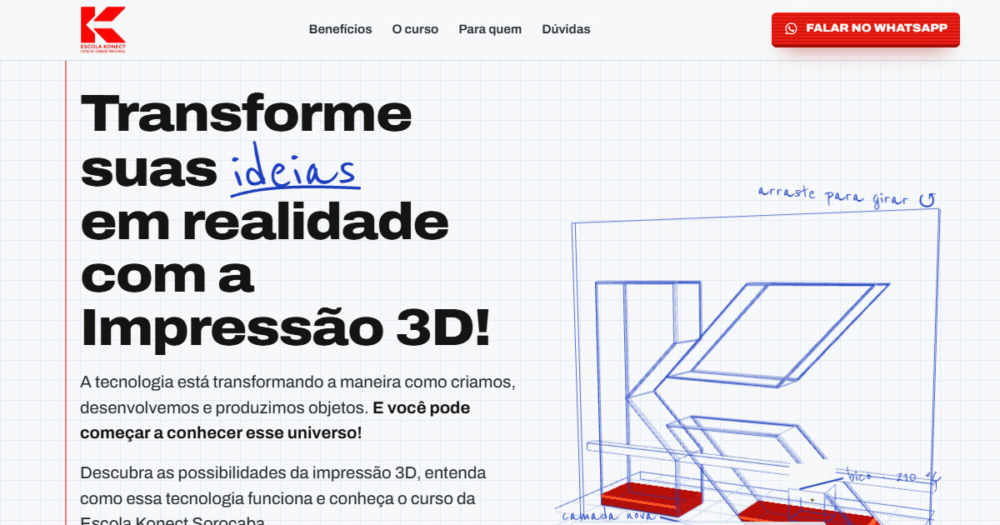
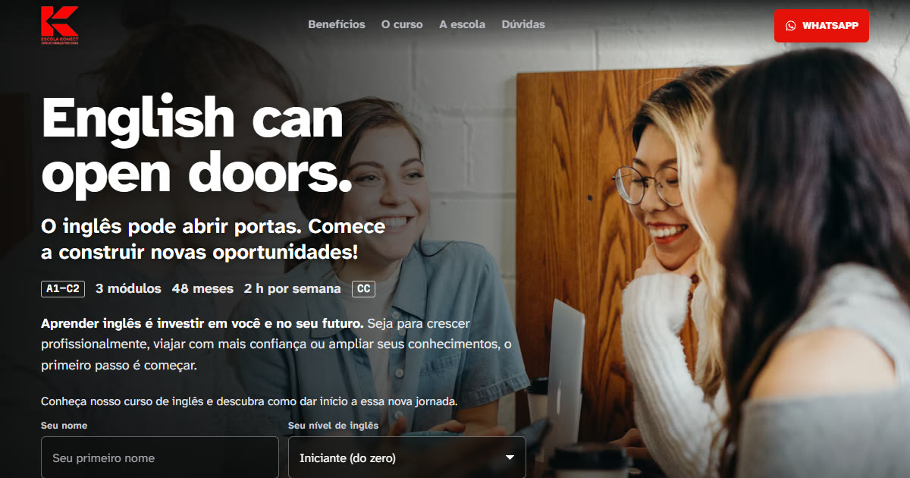

<div align="center">


# Escola Konect Sorocaba · Landing Pages

**Páginas de captação dos cursos de Impressão 3D e Inglês.**
HTML estático, sem build, pronto para subir em qualquer hospedagem Apache.

[](https://lp.escolakonectsorocaba.com)


</div>

---

## As páginas

<table>
<tr>
<td width="50%" valign="top">

### 🖨️ Curso de Impressão 3D
**[`/impressao-3d/`](https://lp.escolakonectsorocaba.com/impressao-3d/)**



Um caderno quadriculado onde a ideia é traço de caneta azul e o objeto real sai em PLA vermelho Konect.

- Impressora 3D em **WebGL (Three.js)** imprimindo o K da Konect camada por camada, com contador de camadas e rotação com o mouse ou o dedo
- Caminho **rascunho → modelo digital → fatiamento → peça impressa** em escada
- Ficha do curso: **40 h · 3 meses · presencial** e conteúdo programático completo
- Galeria com fotos e vídeos reais da escola

</td>
<td width="50%" valign="top">

### 🎬 Curso de Inglês
**[`/ingles/`](https://lp.escolakonectsorocaba.com/ingles/)**



Uma série de streaming: a fala em inglês na legenda e o português logo abaixo.

- Botão **“Ouvir em inglês”** com a voz do navegador e legenda acendendo palavra por palavra
- Formulário (nome + nível) que abre o **WhatsApp com a mensagem pronta**
- Cenas com legenda borrada: **“toque para entender”**
- Módulos em abas, como temporadas: **A1 ao C2 · 48 meses · 384 h**
- Mapa da escola e bastidores com imagens reais

</td>
</tr>
</table>

---

## Estrutura

```text
.
├── impressao-3d/index.html    → /impressao-3d/
├── ingles/index.html          → /ingles/
├── assets/
│   ├── img/                   logos, imagens de compartilhamento (OG)
│   │   ├── escola/            quadros reais do vídeo da escola
│   │   └── generated/         imagens ilustrativas (WebP)
│   ├── video/                 tour da escola e impressoras (MP4, sem áudio)
│   └── icons/                 favicons e ícones do manifest
├── .htaccess                  HTTPS, redirecionamentos, segurança, cache, anti-spam
├── .well-known/security.txt
├── 404.html
├── robots.txt · sitemap.xml · site.webmanifest · favicon.ico
├── PRODUCT.md                 contexto do produto (não publicar)
└── _docs/                     copys, marca, mídia e guia de publicação (não publicar)
```

## Rodar localmente

Não há dependências nem build. Basta servir a pasta:

```bash
python -m http.server 8080
# abra http://localhost:8080/impressao-3d/ e http://localhost:8080/ingles/
```

> As páginas usam caminhos absolutos (`/assets/...`), então abra pelo servidor local, não com duplo clique no arquivo.

## Publicação

Envie para a raiz do subdomínio **`lp.escolakonectsorocaba.com`**:

```text
.htaccess  .well-known/  404.html  favicon.ico  robots.txt  sitemap.xml
site.webmanifest  assets/  impressao-3d/  ingles/
```

**Não envie** `_docs/`, `PRODUCT.md` nem este `README.md`.

**Requisitos:** Apache com `mod_rewrite` e `mod_headers`, e SSL ativo (o `.htaccess` força HTTPS).

**Depois de publicar:**
1. Enviar `/sitemap.xml` no Google Search Console.
2. Testar a prévia de compartilhamento no [Facebook Sharing Debugger](https://developers.facebook.com/tools/debug/).
3. Testar o “Ouvir em inglês” num celular de verdade.

## SEO e segurança

| | |
|---|---|
| **SEO** | URL canônica, Open Graph, Twitter Card, dados estruturados `Course` (Schema.org), sitemap com imagens |
| **Cabeçalhos** | HSTS, CSP restrita às fontes usadas, `nosniff`, `X-Frame-Options`, `Referrer-Policy`, `Permissions-Policy` |
| **Anti-spam (servidor)** | bloqueio de POST, sondagens de WordPress/PHP, query strings maliciosas, scanners e spam de referer |
| **Anti-spam (formulário)** | campo-isca invisível, tempo mínimo de 2,5 s, intervalo de 8 s entre envios, nome sem links ou HTML |
| **Acessibilidade** | HTML semântico, foco visível, `prefers-reduced-motion`, descrições para leitores de tela nos vídeos |

## Conversão

Todos os botões levam ao WhatsApp da escola com uma mensagem pronta para cada contexto. Nenhum dado é enviado a servidor.

📱 **(15) 98108-6795** · 📍 R. Miguel Arcângelo Matielo, 60 · Jardim Carolina · Éden · Sorocaba/SP

## Créditos de imagem

- **`assets/img/escola/` e `assets/video/`**: registros reais da Escola Konect Sorocaba.
- **`assets/img/generated/`**: imagens ilustrativas, sem pessoas reais da escola. Detalhes em [`_docs/media/README.md`](_docs/media/README.md).

---

<div align="center">
<sub>Escola Konect Sorocaba · Centro de Formação Profissional</sub><br>
<sub><a href="https://escolakonectsorocaba.com.br">escolakonectsorocaba.com.br</a> · <a href="https://www.instagram.com/escolakonectsorocaba/">Instagram</a> · <a href="https://www.facebook.com/konect.sorocabaeden">Facebook</a> · <a href="https://www.tiktok.com/@escola.konect">TikTok</a></sub>
</div>
